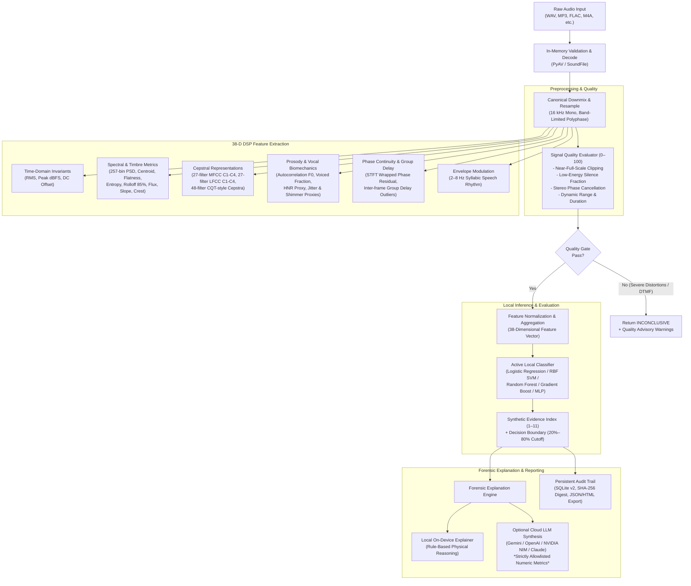

# AegisVoice: Audio Deepfake Detection System
### *An Explainable DSP-First & Machine Learning Pipeline for Detecting Synthetic, Cloned, and Replayed Speech*

[](https://www.python.org/)
[](https://fastapi.tiangolo.com/)
[](https://scipy.org/)
[](https://scikit-learn.org/)
[-003B57.svg?logo=sqlite&logoColor=white)](https://sqlite.org/)
[](http://www.mnnit.ac.in/)
[](LICENSE)

---

## 📌 Executive Summary

The rapid emergence of generative artificial intelligence—specifically deep neural text-to-speech (TTS), neural vocoders (e.g., HiFi-GAN, WaveGlow, MelGAN), and real-time diffusion voice cloning—has made synthetic speech virtually indistinguishable from genuine human utterances to the naked ear. This poses severe security threats to voice biometrics, automated authentication, telephonic fraud prevention, journalism, and public communication.

While conventional countermeasure systems rely heavily on deep neural networks (e.g., AASIST, RawNet2) that operate as opaque black boxes, **AegisVoice** is architected around an **explainable, Digital Signal Processing (DSP)-first philosophy**. The underlying premise is rooted in acoustics and biomechanics: **the physical production of human speech produces subtle time-frequency invariants and phase regularities that synthetic vocoders inherently struggle to replicate without leaving measurable mathematical footprints.**

AegisVoice extracts **38 fine-grained acoustic, spectral, cepstral, prosodic, and phase metrics**, evaluates technical signal health via an independent input-quality engine, and trains local, interpretable machine learning classifiers with rigorous group-aware holdout validation. For human investigators, AegisVoice synthesizes these findings using both a deterministic on-device forensic explainer and an optional, privacy-preserving cloud LLM interface that transmits **zero audio bytes**.

---

## 🏛️ Academic & Project Provenance

* **Project Title:** Audio Deepfake Detection Using Time-Frequency Signal Processing and Machine Learning
* **Course:** Digital Signal Processing (DSP) Final Project (5th Semester)
* **Program:** Bachelor of Technology (B.Tech), Electronics & Communication Engineering (ECE)
* **Institution:** Department of Electronics and Communication Engineering, **Motilal Nehru National Institute of Technology (MNNIT) Allahabad, Prayagraj, India**
* **Academic Session:** 2026–2027
* **Project Group:** **Group G11**
  * **Raj Sharma** (Reg. No. 20244133)
  * **Raju Manjhi** (Reg. No. 20244134)
  * **Rasthapuram Devdatta** (Reg. No. 20244135)
  * **Rathod Ajay** (Reg. No. 20244136)
  * **Rishabh Rawat** (Reg. No. 20244137)

---

## 🌟 Key Features

| Capability | Technical Details |
|---|---|
| **Dual-Path Architecture** | **Full Mode:** FastAPI + SoundFile/PyAV + SciPy + Scikit-Learn for universal multi-format decoding.<br>**Lightweight Fallback:** Zero-dependency pure Python 3.12 standard library server (`app/local_server.py`) with native radix-2 FFT and windowed-sinc resampling for air-gapped systems. |
| **Universal Media Decoding** | Reads uncompressed and compressed formats: `WAV`, `FLAC`, `OGG/Opus`, `AIFF`, `MP3`, `M4A/MP4`, `AAC`, `WMA`, and `WebM`. Downmixes to canonical mono and safely resamples to 16 kHz using band-limited rational resampling (`resample_poly`). |
| **38-Dimensional DSP Vector** | Extracts mathematical descriptors across time, frequency, cepstral, prosodic, and phase domains (Hann-windowed STFT, 512-point real FFT, 25 ms frame, 10 ms hop). |
| **Technical Quality Gate** | Independent 0–100 signal quality engine assessing clipping, extreme low-energy frames, stereo cancellation, and duration—decoupled from spoof confidence. |
| **Local Machine Learning** | Train and compare 5 scikit-learn model families locally: **Logistic Regression**, **RBF SVM**, **Random Forest**, **Gradient Boosting**, and **Multi-Layer Perceptron (MLP)** with grouped holdout splitting to eliminate speaker leakage. |
| **Multi-Provider Forensic LLM** | Plain-English measurement explanations via local on-device heuristics or optional LLMs (**Google Gemini**, **OpenAI GPT-4o**, **NVIDIA NIM**, **OpenRouter**, **Anthropic Claude**). **Zero audio is ever sent to LLMs**—only allowlisted numeric DSP measurements. |
| **Commercial Cross-Check** | Optional integration with **Resemble Detect API** (with explicit opt-in consent and zero-retention mode). |
| **Tamper-Evident Audit & Export** | SQLite schema v2 database, SHA-256 duplicate detection, one-click standalone HTML forensic reports, and JSON/CSV history exports. Raw audio is never stored on disk. |

---

## 🔄 System Architecture & Data Flow



---

## 🔬 Mathematical Formulations & DSP Invariants

The extraction engine operates on frames of length $N = 400$ samples (25 ms at $f_s = 16\text{ kHz}$) with a frame hop of $H = 160$ samples (10 ms), windowed by a periodic Hann window:

$$
w[n] = 0.5 \left(1 - \cos\frac{2\pi n}{N-1}\right), \quad 0 \le n < N
$$

---

### 1. Spectral Analysis & Power Spectral Density (PSD)

For frame $t$, the short-time Fourier transform is computed using a 512-point real FFT on the mean-subtracted canonical frame sequence ($x_c[n] = x[tH + n] - \mu$):

$$
X_t[k] = \sum_{n=0}^{N-1} (x[tH + n] - \mu) \, w[n] \, e^{-j \frac{2\pi k n}{512}}, \quad k = 0, 1, \dots, 256
$$

The single-sided periodogram is normalized by the discrete window energy $\sum w^2[n]$:

$$
P_t[k] = \frac{c[k] \, |X_t[k]|^2}{f_s \sum_{n=0}^{N-1} w[n]^2}
$$

where the scaling factor $c[k]$ accounts for single-sided Nyquist power folding:

$$
c[k] = \begin{cases} 
1, & k = 0 \text{ (DC) or } k = 256 \text{ (Nyquist)} \\ 
2, & 1 \le k < 256 
\end{cases}
$$

---

### 2. Spectral Descriptors & Timbre Invariants

#### Spectral Centroid ($f_{\text{centroid}}$)
The power-weighted center of spectral mass in Hertz, measuring the brightness and frequency balance of the frame:

$$
f_{\text{centroid}} = \frac{\sum_{k=0}^{K-1} f_k \, P_t[k]}{\sum_{k=0}^{K-1} P_t[k]}
$$

#### Wiener Entropy / Spectral Flatness Measure ($\text{SFM}$)
Calculates the ratio of the geometric mean to the arithmetic mean of the power spectrum to identify artificial white noise, vocoder buzz, or robotic flatness:

$$
\text{SFM} = \frac{\exp\left( \frac{1}{K} \sum_{k=0}^{K-1} \ln \max(P_t[k], \varepsilon) \right)}{\frac{1}{K} \sum_{k=0}^{K-1} P_t[k]}
$$

#### Shannon Spectral Entropy ($H_{\text{spectral}}$)
Measures the concentration or dispersion of spectral energy across frequency bins:

$$
H_{\text{spectral}} = -\frac{1}{\ln K} \sum_{k=0}^{K-1} p_t[k] \ln p_t[k], \quad p_t[k] = \frac{P_t[k]}{\sum_{j=0}^{K-1} P_t[j]}
$$

#### Spectral Flux ($\text{Flux}_t$)
Quantifies the rate of local spectral variation by measuring the Euclidean distance between successive normalized magnitude spectra:

$$
\text{Flux}_t = \left\lVert \tilde{X}_t - \tilde{X}_{t-1} \right\rVert_2, \quad \tilde{X}_t = \frac{|X_t|}{\left\lVert |X_t| \right\rVert_2}
$$

---

### 3. Cepstral Invariants (MFCC, LFCC, CQT-Style)

Filter-bank log energies are decorrelated using a Type-II Discrete Cosine Transform (DCT-II):

$$
c_m = \sum_{m'=0}^{M-1} \log(E_{m'}) \cos\left[ \frac{\pi m}{M} \left(m' + \frac{1}{2}\right) \right]
$$

* **MFCC (Mel-Frequency Cepstral Coefficients):** 27 triangular filters spaced on the non-linear Mel scale ($C_1 - C_4$) capturing vocal tract filter shape.
* **LFCC (Linear Frequency Cepstral Coefficients):** 27 linearly spaced triangular filters capturing high-frequency vocoder artifacts ($C_1 - C_4$).
* **CQT-Style Cepstra:** 48 geometrically spaced triangular STFT filters approximating Constant-Q transform resolution.

---

### 4. Prosody, Pitch & Micro-Fluctuations

#### Autocorrelation Pitch ($F_0$)
Evaluated over voiced frames within the lag search range corresponding to $70\text{ Hz} \le F_0 \le 400\text{ Hz}$:

$$
R_x(\tau) = \frac{\sum_{n} x[n] x[n+\tau]}{\sqrt{\sum_n x^2[n] \sum_n x^2[n+\tau]}}
$$

#### Harmonic-to-Noise Ratio ($\text{HNR}$) Proxy
Approximates the ratio of harmonic to noise power from the peak autocorrelation coefficient $R_{\max}$:

$$
\text{HNR} \approx 10 \log_{10} \left( \frac{R_{\max}}{1 - R_{\max}} \right) \text{ dB}
$$

#### Jitter Proxy
Quantifies short-term cycle-to-cycle perturbation in fundamental pitch period duration:

$$
\text{Jitter} = \frac{\frac{1}{M-1} \sum_{i=1}^{M-1} |T_i - T_{i+1}|}{\frac{1}{M} \sum_{i=1}^M T_i}
$$

#### Shimmer Proxy
Quantifies cycle-to-cycle perturbation in speech frame amplitude:

$$
\text{Shimmer} = \frac{\frac{1}{M-1} \sum_{i=1}^{M-1} |A_i - A_{i+1}|}{\frac{1}{M} \sum_{i=1}^M A_i}
$$

---

### 5. Phase Continuity & Group Delay

Neural vocoders that invert spectrograms to audio (e.g., Griffin-Lim, HiFi-GAN) often introduce discontinuous phase jumps or dispersion anomalies.

#### Inter-Frame Phase Advancement Residual ($\Delta \theta_k$)
Measures angular deviation between actual phase advancement and theoretical advancement:

$$
\Delta \theta_k = \angle X_t[k] - \angle X_{t-1}[k] - \frac{2\pi f_k H}{f_s}
$$

#### Group Delay Dispersion ($\tau_g$)
Frequency derivative of the unwrapped phase spectrum:

$$
\tau_g(\omega) = -\frac{d\phi(\omega)}{d\omega}
$$

---

## 📂 Project Structure

```text
2026-10-28new/
├── app/
│   ├── __init__.py
│   ├── main.py                  # FastAPI application entry point, routing, quality gates
│   ├── audio.py                 # Media decoding (PyAV/SoundFile), downmixing, resampling
│   ├── dsp.py                   # 38-D feature extraction, FFT, PSD, filter banks, phase
│   ├── stdlib_dsp.py            # Zero-dependency DSP engine (windowed sinc, radix-2 FFT)
│   ├── local_server.py          # Standalone pure Python fallback server
│   ├── learning.py              # Supervised ML training, evaluation, grouped holdouts
│   ├── database.py              # SQLAlchemy SQLite schema v2 management
│   ├── schemas.py               # Pydantic models for API request/response validation
│   ├── llm_explainer.py         # Multi-provider LLM forensic analysis engine
│   ├── resemble_detect.py       # Resemble Detect API integration client
│   ├── config.py                # System thresholds, port allocation, path constants
│   └── static/                  # Single-page web application frontend
│       ├── index.html           # Main UI dashboard (Analyze, Train, History, AI Analyst)
│       ├── model-datasets.html  # Model and dataset reference catalog
│       ├── app.js               # Reactive frontend logic, SVG rendering, audio playback
│       ├── styles.css           # Modern dark-mode UI styling
│       └── training-template.csv# Reference CSV schema for batch training import
├── data/
│   ├── aegisvoice.sqlite3       # SQLite database (analyses, training examples)
│   └── models/                  # Serialized scikit-learn checkpoints (.joblib)
├── docs/                        # Complete technical specifications & engineering documentation
│   ├── API_CONTRACT.md          # REST API schema documentation
│   ├── ARCHITECTURE.md          # End-to-end data flow and architectural design
│   ├── DSP_FEATURES.md          # Mathematical formulas for all 38 acoustic descriptors
│   ├── DECISIONS.md             # Engineering decision records and rationales
│   ├── EXISTING_PROJECT_AUDIT.md# Comparative audit against previous prototypes
│   ├── EXPERIMENT_PLAN.md       # Evaluation protocol and cross-validation procedures
│   ├── IMPLEMENTATION_STATUS.md # Current verified implementation state
│   ├── MODEL_CARD.md            # ML model boundaries, ethical usage, and limitations
│   ├── PRIVACY_AND_DATA_RETENTION.md # In-memory processing and retention rules
│   ├── PROVIDER_API_ACCESS.md   # Cloud LLM provider configuration and security guides
│   ├── SECURITY_THREAT_MODEL.md # Threat analysis, attack vectors, and mitigations
│   └── THRESHOLDS.md            # Operational thresholds and quality criteria
├── reports/                     # Test execution logs and validation artifacts
├── scripts/
│   └── create_sbom.py           # Software Bill of Materials (SBOM) generation utility
├── tests/                       # Unit tests and DSP verification suite
│   ├── test_dsp.py              # Synthetic signal DSP validation
│   ├── test_learning.py         # Model training, scoring, and holdout tests
│   └── test_offline.py          # Pure Python fallback verification
├── install_aegisvoice.bat       # One-click Windows dependency installer
├── start_aegisvoice.bat         # One-click Windows application launcher
├── start_aegisvoice.ps1         # Dynamic port selection and environment orchestration
├── stop_aegisvoice.bat          # Safe background server shutdown utility
├── stop_aegisvoice.ps1          # Process management and termination script
├── requirements.txt             # Production Python dependencies
├── LICENSE                      # MIT Open-Source License
└── LICENSES_AND_ATTRIBUTION.md  # Third-party software attribution and dependencies
```

---

## 🚀 Quick Start Guide

### Option 1: One-Click Windows Launcher (Recommended)

1. **Install Dependencies:** Double-click `install_aegisvoice.bat` (creates `.venv` and installs packages).
2. **Start the Application:** Double-click `start_aegisvoice.bat`.
   * The script automatically selects an available port (`http://127.0.0.1:8000` through `8010`) and opens your default browser.
3. **Stop the Application:** Double-click `stop_aegisvoice.bat`.

---

### Option 2: PowerShell Manual Setup

```powershell
# 1. Navigate to the project directory
cd "D:\notes\sem5\dsp final project\working_with_project\2026-10-28new"

# 2. Create and activate a Python 3.12+ virtual environment
python -m venv .venv
.\.venv\Scripts\Activate.ps1

# 3. Install dependencies
pip install -r requirements.txt

# 4. Launch the FastAPI server
uvicorn app.main:app --host 127.0.0.1 --port 8000 --reload
```
Open **[http://127.0.0.1:8000](http://127.0.0.1:8000)** in your browser.

---

### Option 3: Zero-Dependency Offline Fallback Mode
For air-gapped environments where third-party packages cannot be installed, launch the native standard library server:

```powershell
python -m app.local_server --host 127.0.0.1 --port 8000 --data-dir data
```
*Note: Offline fallback inspects PCM WAV files (up to 8 MB, 30s) using pure Python mathematical routines and does not load trained scikit-learn models.*

---

## 🖥️ Web Interface Walkthrough

```text
┌────────────────────────────────────────────────────────────────────────┐
│  AegisVoice │ Audio Deepfake Detector                   [● Status: OK] │
├────────────────────────────────────────────────────────────────────────┤
│  [ Upload Audio File ]  Drag & drop WAV, MP3, FLAC, M4A, OGG...       │
│                                                                        │
│  Decision: LIKELY HUMAN (Score: 2.1 / 11)   Quality Ring: 98/100 [PASS]│
│  ────────────────────────────────────────────────────────────────────  │
│  Waveform Display (SVG)        Mean Power Spectral Density (257 Bins)  │
│  [ ∿∿∿∿∿∿∿∿∿∿∿∿∿∿∿∿∿∿∿∿∿∿∿∿∿ ]    [ ▅▇█▆▄▃▂                           ]  │
│                                                                        │
│  Log-Frequency STFT Spectrogram (48 Bins x 600 Frames, 80 dB Range)    │
│  [ ████████████████████████████████████████████████████████████████ ]  │
│                                                                        │
│  Acoustic Breakdown:                                                   │
│  • Pitch (F0): 134.2 Hz      • Jitter Proxy: 1.2%    • HNR: 18.4 dB   │
│  • MFCC C1-C4: [-18.2, 8.4]  • LFCC C1-C4: [12.1]    • Phase Res: 0.14│
│                                                                        │
│  AI Forensic Analyst:                                                  │
│  [Explain via Local DSP Heuristics]  [Select Provider: Gemini / GPT-4o]│
│  "Audio exhibits authentic vocal tract resonance, healthy cycle-to-    │
│   cycle pitch micro-tremors, and continuous phase progression..."     │
└────────────────────────────────────────────────────────────────────────┘
```

1. **Analyze View:** Upload any common audio format. Preview with the built-in browser-safe player, inspect interactive SVG waveforms, examine the 257-bin PSD curve and 48-band log-frequency spectrogram, and view the 0–100 technical quality indicator.
2. **Train & Compare View:** Import audio directories or CSV manifests (`filename,label,group_id`). Compare Logistic Regression, RBF SVM, Random Forest, Gradient Boosting, or MLP on a group-aware holdout. Inspect confusion matrices, ROC AUC, Balanced Accuracy, and EER.
3. **AI Forensic Analyst:** Generate plain-English forensic findings using local on-device heuristics or allowlisted cloud LLMs. Optionally cross-verify with Resemble Detect.
4. **History & Export:** Review historical evaluations stored in SQLite. Export reports as interactive standalone HTML files or download datasets as JSON/CSV.

---

## 🧪 Experimental Validation & Holdout Snapshot

To prevent data leakage caused by identical speakers or recording conditions appearing in both training and test sets, AegisVoice enforces **Group-Aware Splitting**:

$$
\text{Group}(x_i) \cap \text{Group}(x_j) = \emptyset \quad \forall x_i \in \mathcal{D}_{\text{train}}, \; x_j \in \mathcal{D}_{\text{test}}
$$

### Benchmark Snapshot (Sample Corpus)
On the provided 42-clip sample corpus (`deepfake_sample_audio`) evaluated on 16 held-out test clips across 8 distinct recording groups:

```text
Confusion Matrix:
                    Predicted Human    Predicted Synthetic
Actual Human               10                   0
Actual Synthetic            0                   6

• Classification Accuracy:  100.0%
• Balanced Accuracy:        100.0%
• Area Under ROC (ROC AUC):   1.00
• Equal Error Rate (EER):     0.0%
```
> [!NOTE]
> *Scientific Disclaimer:* These evaluation figures are derived from the exploratory sample corpus. Synthetic scores are uncalibrated and represent relative signal evidence, not absolute probabilities. Independent external validation on large-scale benchmarks (such as ASVspoof 2021 DF / In-the-Wild datasets) is recommended before critical deployment.

---

## 🔒 Privacy, Security & Data Retention

* **Zero Audio Retention:** Uploaded audio files are processed exclusively in RAM and immediately discarded. **Raw audio is never written to disk or database tables.**
* **Cryptographic Signatures:** Files are indexed solely by their SHA-256 hash digests, sanitized file names, byte counts, and derived numeric vectors.
* **Strict LLM Privacy Boundary:** When utilizing cloud LLM forensic explainers (Google AI Studio, OpenAI, NVIDIA NIM, Anthropic), **no audio, spectrograms, or user identifiers are sent**. Only allowlisted numerical DSP statistics are transmitted. API keys are kept in memory and never written to disk.

---

## 🛠️ Verification & Test Suite

Run the comprehensive unit test suite:

```powershell
# Run all unit tests
python -m unittest discover -s tests -p "test_*.py" -v
```

The test suite validates:
* Exact mathematical reconstruction of synthetic tone and silence fixtures.
* Phase continuity and group delay calculation.
* Anti-aliasing attenuation during rational resampling.
* Database persistence and schema version 2 migration integrity.
* Grouped holdout splitting algorithms and classifier convergence.

---

## 📚 References & Research Foundations

1. **ASVspoof 2021 Consortium:** *ASVspoof 2021: Towards Spoofed and Deepfake Speech Detection in the Wild*, IEEE/ACM Transactions on Audio, Speech, and Language Processing.
2. **Audio Deepfake Survey (2023):** Z. Khan, et al., *A Survey on Audio Deepfake Detection: Methods, Challenges, and Future Directions*.
3. **Spectral Forensics (2025):** Recent advances in time-frequency artifact analysis and phase discontinuity modeling in generative vocoders.

---

## 📄 License & Attribution

This project is released under the **[MIT License](LICENSE)**.
Third-party libraries, audio decoders, and academic attributions are detailed in **[LICENSES_AND_ATTRIBUTION.md](LICENSES_AND_ATTRIBUTION.md)**.
